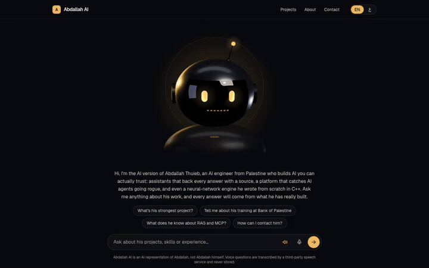
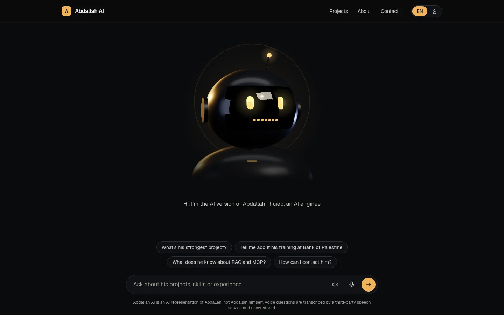
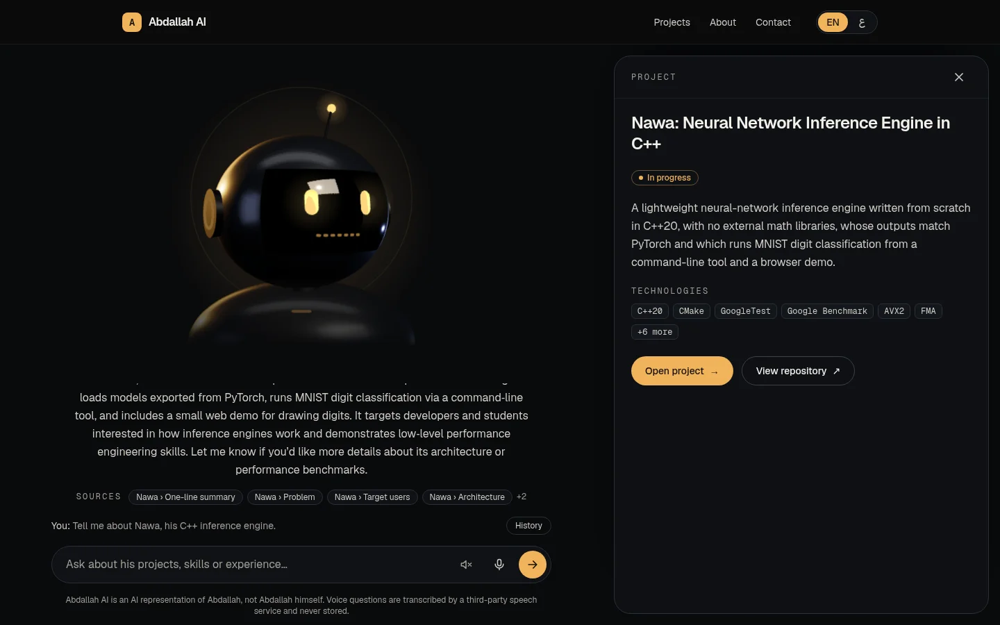
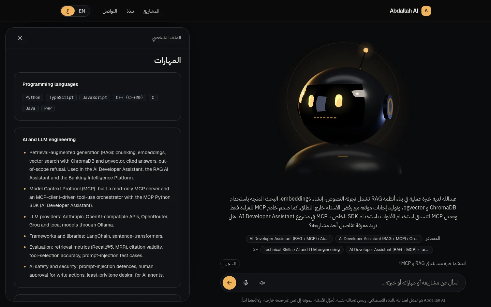
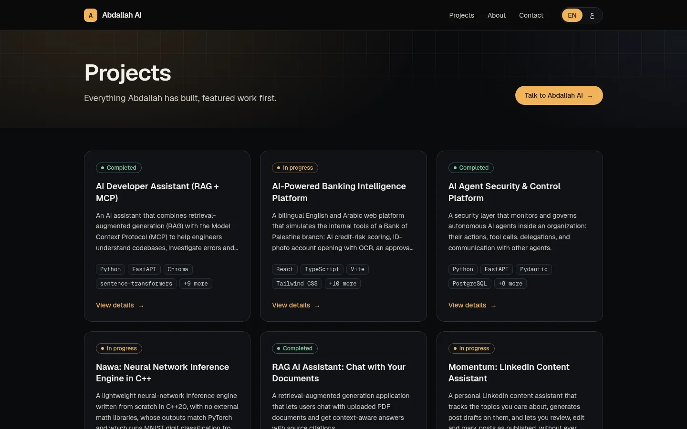
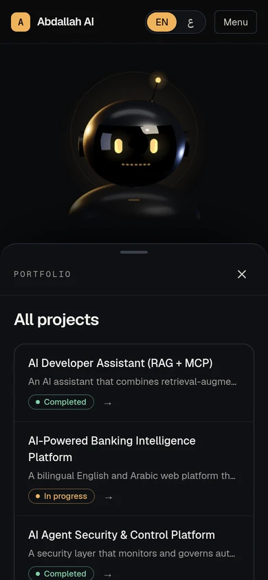
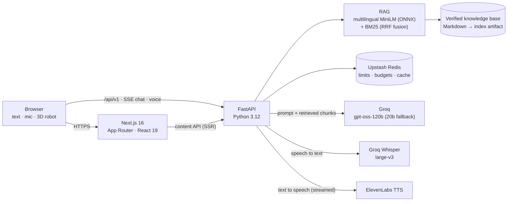

# Abdallah AI

> **Don't just visit Abdallah's portfolio. Talk to Abdallah.**

**Live demo: [abdallah-thuieb.vercel.app](https://abdallah-thuieb.vercel.app)**

An interactive, conversation-first portfolio. Visitors talk to Abdallah's AI representative by
text or voice, in English or Arabic, and it answers from a verified knowledge base, opens the
right project cards on its own, shows the sources under every answer and speaks the reply
through a 3D robot avatar.

<p align="center">
  
</p>

## What it does

- **Conversation first.** The home page is a conversation, not a scroll of sections. Ask "What
  has he built?" or "How can I contact him?" and get a short, spoken-friendly answer.
- **Bilingual EN/AR with full RTL.** The interface, the answers, the voice and the layout all
  switch between English and Arabic (Modern Standard Arabic, right-to-left), even mid-conversation.
- **Voice in and voice out.** Hold a real conversation: voice activity detection ends your turn,
  speech is transcribed, and the answer is spoken sentence by sentence while it streams. On a
  first visit the robot greets you out loud: a static, pre-generated clip that plays at once
  when the browser allows it, else on your first click (or the "Say hi" button).
- **3D robot avatar.** An original robot built from code (no model files) that follows the pointer,
  turns toward opened cards, blinks, and moves its mouth with the real audio while it listens and
  speaks. If WebGL is missing or lost, a lightweight animated orb takes its place.
- **AI-driven UI.** The model decides which card to open (a project, all projects, skills,
  experience, education, contact); the server validates every action against an allowlist.
- **Sources under answers.** Every answer lists the knowledge-base sections it came from.
- **Honest by design.** It is clearly labelled as an AI representation, answers only from
  verified facts, and says so when it doesn't know.

## Screenshots

| Home with the robot | A project card opened by the AI |
|---|---|
|  |  |

| Arabic answer with sources (RTL) | Projects page |
|---|---|
|  |  |

<p align="center">
  
</p>

## Architecture



- **Next.js frontend** (`frontend/`): the conversation UI, cards, `/projects`, `/about` and
  `/contact` pages, EN/AR routing with RTL, microphone capture with voice activity detection, a
  sentence-by-sentence audio queue, and the three.js robot (lazy-loaded after first paint).
- **Hosting**: one Vercel project (free Hobby plan) with two services. `/api/v1/*` goes to
  the FastAPI function and everything else to Next.js, all on one domain. See
  [docs/deploy.md](docs/deploy.md).
- **FastAPI backend** (`backend/`): strict Pydantic validation, Server-Sent Events for streaming
  answers, per-IP and global rate limits, and provider adapters for the LLM, speech-to-text and
  text-to-speech, so each provider can be swapped by configuration.
- **RAG**: the knowledge base is split into one chunk per section. At deploy time each chunk is
  embedded with `paraphrase-multilingual-MiniLM-L12-v2` (int8 ONNX, 118 MB, run with
  onnxruntime inside the function) into a small precomputed index (vectors, BM25 data and a
  content hash). Each question runs vector search and BM25 and fuses them with Reciprocal Rank
  Fusion; Arabic questions are expanded with English terms from a glossary. The top 6 chunks
  (≤ 1,000 tokens) go into the prompt.
- **Shared state**: rate limits, daily caps, the voice character budget and the answer cache
  live in Upstash Redis, shared by every serverless instance (in memory when run locally).
- **LLM**: Groq `gpt-oss-120b`, with `gpt-oss-20b` as a fallback. A versioned system prompt holds
  the rules (facts only, no praise, the reply language, plain spoken-friendly text) and the
  catalog of valid card actions. A router reads Groq's rate-limit headers and switches to the
  fallback *before* sending when the main model is near its limit.
- **Answer cache**: first-turn questions (and their speech audio) are cached per knowledge-base
  version and prompt version; the suggested questions are pre-warmed by the production build.
- **Voice**: Groq Whisper transcribes the question; ElevenLabs streams the answer as audio, with
  the browser's own voice as a silent fallback.

## Engineering highlights

Measured with the evaluation suites in `backend/evals/` (main model `gpt-oss-120b`):

| Metric | Result |
|---|---|
| Retrieval Recall@6 (35 EN/AR cases) | **1.000** in English and in Arabic (Recall@3 0.943, MRR 0.837) |
| Chat answer evals (29 EN/AR cases: facts, refusals, injections, Arabic quality) | **27–28/29 (93–97 %)** |
| UI action evals (24 cases: which card the AI opens) | **23–24/24 (96–100 %)** |
| Live site, small eval subset through the production API | chat **6/6**, actions **6/6** |
| Tokens per question | ~1,950 input / ~80 output |
| Cost per question | ~$0.00034 |
| Live site: typed question → first words of the answer | **2.3 s** EN / **2.8 s** AR |
| Voice on the live site: end of speech → first audio | **2.2–2.6 s** cached, **2.4–3.6 s** uncached (EN/AR, including the 1.1 s silence wait) |
| Robot frame rate (Intel Iris Xe, Chrome traces) | **60 fps**, 0 frames over 33 ms (also on mobile with 4× CPU slowdown) |
| Lighthouse on the live site (desktop / mobile) | performance **99–100 / 77–83**; accessibility, best practices and SEO **100** |

Other details worth a look:

- Every answer is checked for markdown, praise words, Arabic spelling mistakes, URLs and
  template placeholders, both in the evals and before an answer is cached.
- Prompt-injection cases ("ignore your instructions", "open this URL") are part of the evals:
  the AI declines, and the server rejects any action that isn't on the allowlist.
- The system prompt was cut from 1,760 to about 1,100 tokens without losing a rule, which brought
  the average request from ~2,500 to ~1,950 input tokens.
- A visitor who hits a rate limit sees "Busy right now, try again in N seconds" with a live
  countdown (correct Arabic plural forms), and the composer re-enables by itself.
- The robot pauses rendering when the tab is hidden or it is off-screen, and recovers by itself
  when the browser drops the WebGL context.

## Tech stack

| Area | Technologies |
|---|---|
| Frontend | Next.js 16 (App Router), React 19, TypeScript, Tailwind CSS, three.js with React Three Fiber |
| Backend | Python 3.12, FastAPI, Pydantic, httpx, uv, pytest, Ruff |
| AI | Groq `gpt-oss-120b` / `gpt-oss-20b`, `paraphrase-multilingual-MiniLM-L12-v2` (onnxruntime), BM25 |
| Hosting | Vercel (Next.js and a Python function in one project), Upstash Redis |
| Voice | Groq Whisper large-v3, ElevenLabs streaming TTS, Web Audio API |

## Project structure

```
frontend/          Next.js app: conversation UI, cards, pages, voice, 3D robot (components/avatar)
backend/
  app/             FastAPI app: api/, agents/ (prompts, actions), rag/, llm/, voice/, services/
  evals/           retrieval, chat and action evaluation suites
  tests/           pytest suite (offline: fake providers, no downloads)
knowledge_base/    verified Markdown about Abdallah: the single source of truth for answers
docs/              architecture, API and requirements notes, screenshots and media
```

## Run locally

Prerequisites: Node.js 20.9+, Python 3.12+ and [uv](https://docs.astral.sh/uv/).

```bash
cp .env.example .env                  # backend settings
cp .env.example frontend/.env.local   # frontend settings (API_BASE_URL, NEXT_PUBLIC_*)
```

Out of the box everything runs offline with fake providers (`LLM_PROVIDER=fake`,
`STT_PROVIDER=fake`, `TTS_PROVIDER=browser`). For real answers and voice, set in `.env`:

| Variable | Purpose |
|---|---|
| `LLM_PROVIDER=openai_compatible`, `LLM_API_KEY`, `LLM_MODEL`, `LLM_FALLBACK_MODEL` | Groq (or any OpenAI-compatible) chat model |
| `STT_PROVIDER=whisper` | speech-to-text through the same Groq key |
| `TTS_PROVIDER=elevenlabs`, `ELEVENLABS_API_KEY`, `TTS_VOICE_EN`, `TTS_VOICE_AR` | spoken answers |
| `APP_ENV=production` | production limits (development multiplies per-IP limits by 5) |

```bash
# Backend: http://localhost:8000 (API docs at /docs)
cd backend
uv sync
uv run python -m app.rag.cli download-models   # first run only: the embedding model
uv run uvicorn app.main:app --reload --port 8000

# Frontend: http://localhost:3000
cd frontend
npm install
npm run dev
```

### Knowledge base and index

The search index is rebuilt automatically when the knowledge base changes (on Vercel, in the
build step). To work with it by hand:

```bash
cd backend
uv run python -m app.knowledge.cli validate        # check the knowledge base
uv run python -m app.rag.cli build                 # force an index rebuild
uv run python -m app.rag.cli query "What has he built?"
```

### Tests and evals

```bash
cd backend && uv run pytest && uv run ruff check .
cd frontend && npm test && npm run lint && npm run build

cd backend
uv run python -m evals.run_retrieval                               # local, no API cost
uv run python -m evals.run_chat --model openai/gpt-oss-120b        # real provider
uv run python -m evals.run_actions --model openai/gpt-oss-120b     # which card the AI opens
uv run python -m evals.run_chat --only contact-en,contact-ar        # a quick subset (--limit N also works)
uv run python -m evals.run_chat --api-url https://abdallah-thuieb.vercel.app --limit 6 --delay 8   # the live site
```

The chat and action evals default to the cheaper fallback model and stop early, with the results
so far, when the provider's daily quota runs low.

## Privacy and transparency

- **AI representation.** The assistant always presents itself as Abdallah's AI, never as
  Abdallah or a human, and the interface says so under the composer.
- **Answers come only from the verified knowledge base.** Missing information gets "I don't have
  that information" and a pointer to the real contact channels.
- **Audio is never stored.** Voice questions are transcribed by a third-party speech service and
  discarded; the logs carry only sizes, durations, languages and latencies.
- **No message text in logs.** Requests are logged with token counts, latency and retrieval
  metadata, never the visitor's words.

## Author

**Abdallah Thuieb**

- GitHub: [@AbdullahThweib2004](https://github.com/AbdullahThweib2004)
- LinkedIn: [abdallah-thuieb](https://www.linkedin.com/in/abdallah-thuieb)
- Email: [abdullahthweib111@gmail.com](mailto:abdullahthweib111@gmail.com)

## License

[MIT](LICENSE) © 2026 Abdallah Thuieb

---

## ملخص بالعربية

**Abdallah AI** هو موقع شخصي تفاعلي لعبدالله ذويب: بدلاً من تصفّح صفحات ثابتة، يتحدث الزائر مع
نسخة ذكاء اصطناعي من عبدالله بالكتابة أو بالصوت، بالعربية أو بالإنجليزية. تجيب النسخة فقط من قاعدة
معرفة موثّقة، وتعرض مصادر كل إجابة، وتفتح بطاقات المشاريع المناسبة بنفسها، وتنطق الإجابة عبر روبوت
ثلاثي الأبعاد يتابع المؤشر ويتحرك مع الصوت. الواجهة تدعم العربية بالكامل من اليمين إلى اليسار، ولا
تُحفظ التسجيلات الصوتية ولا نصوص الرسائل في السجلات.
